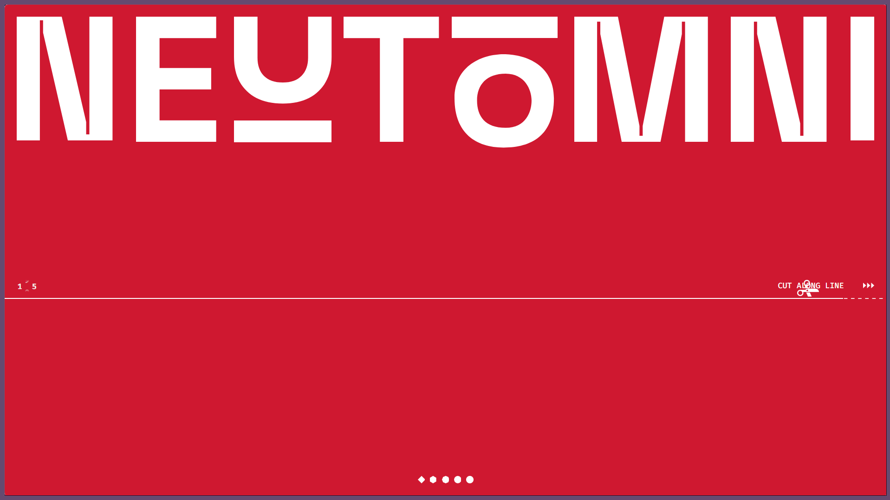
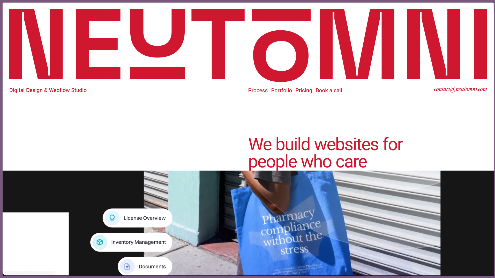
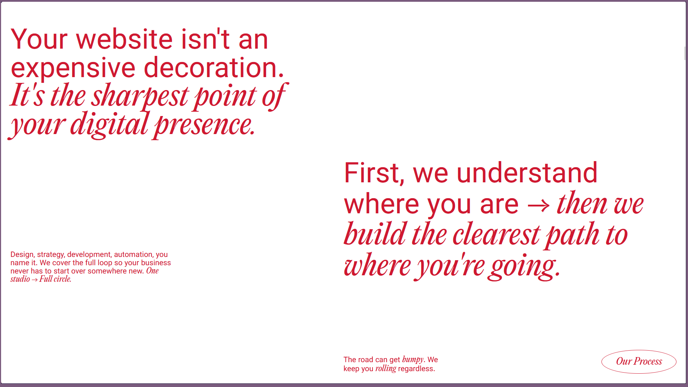
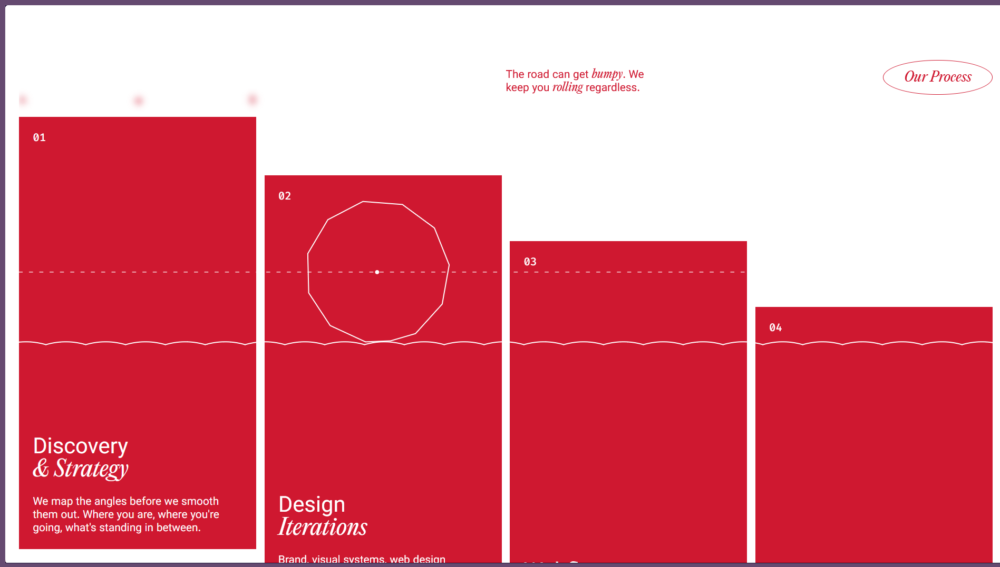
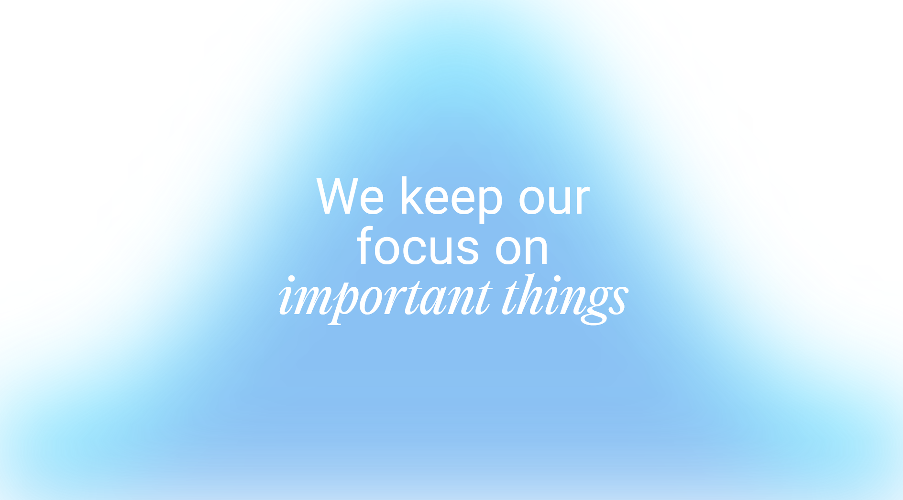
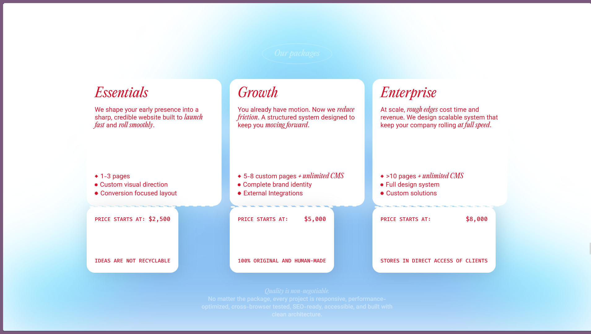
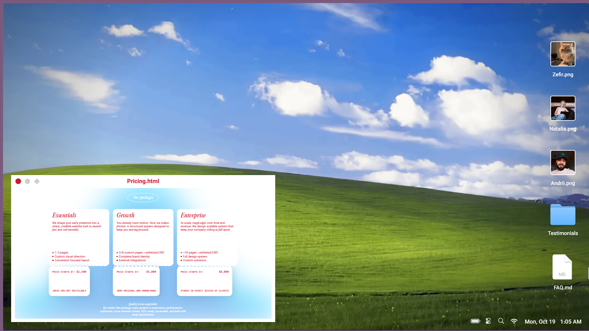
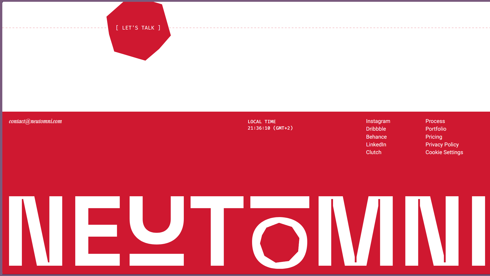

# awwwards-mcp

Free, open-source MCP server that gives AI agents design inspiration from
[Awwwards](https://www.awwwards.com/) — the Mobbin-style visual reference loop,
sourced from the web's best award-winning websites.

[](https://m8ven.ai/mcp/insane0777-awwwards-mcp-12ujax?s=readme)

<a href="https://github.com/INSANE0777/Awwwards-mcp"></a>

Your agent searches in natural language ("dark 3D portfolio sites", "soft pastel
e-commerce"), sees **real screenshots inline**, and pulls the **design DNA** of any
site: color palette, tech stack, design elements, award history. Then it goes past
inspiration: point it at **any link** and it band-maps the page, censuses scroll and
hover motion (keyframes, measured scrub curves), fingerprints the framework, captures
canvas pose grids, and reads the site's bundles when a mechanism is unclear. From that
evidence it **recreates the page section by section**, then converts the build into a
runnable **Vite, Astro or Next.js project** with a measured motion manifest and
per-section hooks. Close the loop with **`verify_build`** (band + motion scoring,
measured perf) and generate GSAP timelines from the captured motion.

And it's not just Awwwards websites — every capture, census, and verification
tool **runs on any URL**. Just give it any site link and tell it to recreate:
band-map it, study its motion, rebuild section by section, and score your
build against the original.

Free-text queries run on a porter-stemmed, prefix-matching FTS5 index with BM25
ranking — "magazines" now finds Magazine-tagged sites (68 on the live index),
best matches first, where the old substring path returned zero. Multi-word
queries keep AND semantics: every token must hit the same site.

## Tools

| Tool | What it does |
|------|--------------|
| `search_sites` | Search by color, tags, technology, award type or free-text query; e.g. `award: "soty"`, `award: "nominees"`, `award: "ecommerce"` (winners), or a technology alias like `technology: "nextjs"` which canonicalizes to the live slug. Multi-word queries match against the local FTS5 index and rank BM25 (title hits lead); zero results come with loose-match and taxonomy-tag hints. Default full results include each site's screenshot; use `responseMode: "compact"` for concise cards and inline previews of only the first two results on the requested page. |
| `get_site_details` | Design DNA for one site: palette, technologies, elements, awards, description. Batch (`slugs`, up to 10) is compact enrichment for a shortlist — `compactSiteDetails` per slug (lists as counts, ≤500-char description, awards), cached/fetched/error status, no inline images. |
| `compare_sites` | Compare 2–3 sites' design DNA and jury scores as text-only JSON. Uses cached details or fetches missing detail pages. |
| `create_design_brief` | Turn 2–5 selected site slugs plus a required project goal into a deterministic, cited build brief. Uses cached detail/element evidence and cached Motion DNA first, fetches only missing details, returns Markdown plus versioned JSON, and runs browser band analysis only with `includeStructure: true`. |
| `get_index_status` | Read local index count, crawl progress, last success/error, lock state and freshness without network requests. |
| `get_index_stats` | Aggregate metrics over the **local cache only** (zero network). **All-time:** site count, element count and technology/tag frequency (`items[].tag`). **Windowed** by `windowDays` (default 90, 1–3650): cached details, palette colour frequency and jury score stats (n/avg/median) from at most the 500 most recently fetched detail rows, plus Motion DNA library frequency. Coverage is labelled `"locally cached subset"` on every metric; `windowDays`/`detailsCached`/`detailParseCap` appear only on the windowed metrics, while sites/elements/technologies are explicitly all-time. `top` caps each frequency list (default 10, 1–50). Aggregates only — no site slugs or titles. Personal, non-commercial use. |
| `get_site_elements` | Component-level visuals for one site: each element's poster image inline (3D models, video content, mobile layouts, microcopy…) + video URLs. |
| `list_categories` | Every filter the agent can search by (200+ tags, 27 colors). |
| `get_collections` | Browse Awwwards' curated and member collections. No slug lists collections (paginated, ~32 per page, `owner`/`ref` on every row); a slug returns one page of that collection's site cards (curated e.g. `brutalism`, or `owner/slug` for member collections; `page` works for collections too). Results expose `siteCards` separately from `items` (all collectables), so element-only collections return empty sites rather than a parser error. 7-day local cache. Personal, non-commercial inspiration use. |
| `search_directory` | Browse the Awwwards directory of agencies, studios and freelancers: name, profile slug, location, website and award counts. Filters are path-based (`country`, `category`, `budget`; one per request — e.g. budget `over_hundred_thousand`). Country must be canonical and case-sensitive (`United States`, not `united states`). Results carry `applied`/`ignored` filter arrays; free-text `query` is matched client-side over the one fetched page. Contact details are stripped. 7-day local cache. Personal, non-commercial inspiration use. |
| `get_annual_categories` | Official Annual Awards categories (Site of the Year, Agency of the Year, …) with nominee counts from Awwwards' public read-only API. Nominee details hydrate on request. Personal, non-commercial inspiration use; media URLs are reference-only. |
| `get_annual_nominees` | Nominees in one Annual Awards category, hydrated on demand at 1 request/second (default 10, max 20). Site summaries include `siteSlug` and `inLocalIndex` so agents can jump to `get_site_details` when the daily index has the site. |
| `get_annual_nominee` | One Annual Awards nominee in full — site: date, description, designBy, country, images/videos; agency: location, avatar, award tag counts, featured projects. Accepts a UUID, a full `/api/annual/nominees/...` path, or category+slug; the slug form may hydrate up to 20 uncached nominees at 1 req/s (~20s worst case), so prefer an id when known. Media URLs are reference-only (`mediaNote: "reference-only"`); nothing is downloaded. |
| `capture_live_site` | Optional: fresh full-page screenshot of any live URL. Waits for `load` + a settle window with a bounded pre-scroll, so heavy sites work (`waitStrategy: "networkidle"` available). Pass `viewport: "mobile"` for the 390×844 iPhone-class render (`"desktop"` 1440×900 default). (needs [playwright](https://playwright.dev)). |
| `analyze_page_structure` | Section band map of any page (live URL or local file:// build): tag, background, offset, height per band. Compare a reference site's structure against your build. Same heavy-site-friendly wait (`waitStrategy: "networkidle"` available); `viewport: "mobile"` analyzes the phone-class layout (`"desktop"` default). `compare: "mobile"` adds a second 390×844 capture and returns `mobileBands` + `diff: {heightDelta, bandsAdded, bandsRemoved, reordered}` (label-matched); if the mobile capture fails you still get the desktop result plus `mobileError`. Absent, the response is unchanged. (needs [playwright](https://playwright.dev)). |
| `record_site_motion` | Optional: short motion-through video of a live URL — preloader, scroll-triggered and hover/cursor animations. Returns an inline filmstrip JPEG plus the saved .webm path. `viewport: "mobile"` records at phone size — the filmstrip renders at the selected viewport, no pillarboxing (`"desktop"` default). Every recording also produces a **Motion Evidence Sheet** (`sheet.html` + `motion-sheet.md`): census-directed keyframes, consecutive-frame diff masks, an onion-skin composite, a cursor-trail overlay and a phase timeline — motion video turned into a document a model can actually read. Degrades gracefully: recording never fails because the sheet does. (needs [playwright](https://playwright.dev) + ffmpeg-static). |
| `search_elements` | Search the inspiration-elements gallery (footer, hero, pricing, 404…) by free text; ranks BM25 over title/author/category. |
| `get_element` | One element record: title, category, author, built-with stack, related elements and its media URL (image or video) pointing at awwwards' CDN. |
| `get_motion_dna` | Runtime motion fingerprint of a live URL: animation libraries, render engines, ScrollTrigger stats (trigger count, scrub ratio), tween easing/duration vocab and the scroll model. Fresh capture or cached capture with timestamp. |
| `analyze_scroll_map` | Per-element scroll-motion census of any URL: selector path, trigger source (gsap-scrolltrigger / native css scroll & view timelines / data-attr / css-keyframe / SMIL), animated props, duration, easing, scrub/pin flags and SVG stroke draw-ins — the rebuild recipe an agent can wire straight into GSAP timelines. Optional `scrubProbe` re-drives the page through ≤8 scroll steps and samples each scrubbed trigger's real progress curve (`scrubCurves`); every payload ends with a `choreography` block — `hints[]` (selector/value/source) and `groups` read from `gsapTriggers` tween vars and stepped sibling `delayMs`. (needs [playwright](https://playwright.dev)). |
| `analyze_hover_census` | Hover-interaction census: extracts `:hover` rules from stylesheets, then samples up to 20 interactive elements before/after hover — transform/color/filter diffs plus transition timing (ms + easing). The hover recipe for rebuilds, no video required. (needs [playwright](https://playwright.dev)). |
| `analyze_bundle` | Bundle forensics for a live page: fetches the page once, downloads its script chunks (script tags, inline scripts, and modulepreload/preload-as-script hints; bounded: ≤40 chunks / 10MB / 1 request/second), saves + hashes them locally, optionally de-obfuscates with webcrack if installed, and greps keywords across the code — chunk paths + match lines so an agent can read the actual animation mechanism instead of guessing. Optional `edges` adds the static import graph over the captured chunks. Needs no browser. |
| `analyze_network_capture` | Offline API-surface evidence from a local HAR 1.2 file (a browser DevTools export): requests grouped by method + origin + path template (dates, versions, UUIDs, hex ids and numbers templated; emails, tokens and long high-entropy segments redacted), with counts, statuses, content types and query names only. Reads the file only — never fetches recorded URLs and never returns bodies, headers or query values. 50 MB / 2000-entry caps; `evidenceCoverage` discloses what was excluded. No network. |
| `audit_url` | Runtime + static performance **evidence** for any live URL — never a grade. Runtime: installed Chrome/Edge over raw CDP (no playwright) measures fps, dropped frames, long tasks/animations and layout thrash (`perf: {error}` when no browser exists). Static: fetches the page HTML + up to 8 same-origin CSS/JS assets (≤2MB each, one shared 1 req/s limiter, 10s default timeouts), resolving refs against the final post-redirect page URL; asset redirects leaving that origin are rejected. Scans them for animation anti-patterns and returns severity-sorted findings (`count`, `worst`, ≤50 `findings`, `coverage: {assetsScanned, failed}`) so `worst` is always included. Each half degrades independently. Personal, non-commercial use; audit only URLs you are authorised to inspect. |
| `analyze_accessibility` | Accessibility **evidence** from a live page — explicitly not a WCAG pass/fail. Samples up to `limit` (default 100, max 200) visible text nodes with computed colour and a background **composited bottom-up from the ancestor stack** for fully opaque chains (colour alpha layers; reported as final `rgb()`), then the contrast ratio (worst pairs + selector paths). A sample under any ancestor CSS opacity group (<1) is **excluded from ratios** and counted in `coverage.skippedOpacityGroups` — never approximated. Background images, gradients and pseudo-elements are not composited either, so contrast stays heuristic there. Also: image alt coverage; heading ladder issues; focusable/positive-tabindex counts plus `outline:none` stylesheet rules; unlabeled form controls; document `lang`/title. Returns `coverage`, `heuristic: true` and the note "Evidence only — not a WCAG pass/fail". Accepts http(s) URLs only; degrades to `{error}` when playwright is missing. (needs [playwright](https://playwright.dev)). |
| `build_project` | Convert a single-file exact rebuild (any local `.html`, e.g. the rebuild flow's `full-page-exact.html`) into a runnable **Vite**, **Astro** or **Next.js** project: sections become components, CSS splits per section, gsap timelines re-wire in the framework idiom (`useEffect` + `gsap.context` on Next), assets carried. Reads a local file and writes the project dir — the suite's one local-write tool. |
| `verify_build` | Score a build against a reference site: band-map compare (Dice score) + motion-fingerprint diff (trigger mix, scrub/pin, easing vocabulary, native scroll timelines) → 0–100 score, pass/warn/fail verdict and evidence lines. The design-loop gate: build → verify that band's score → fix → re-verify. Optional `domDiff` adds a body-subtree structural diff (missing/extra/reordered/rect drift) between reference and build. (needs [playwright](https://playwright.dev)). |
| `verify_flow` | Step-aligned interaction-flow comparison: runs the same 1–6 scroll/click/wait steps on a build and a reference URL (two fresh headless launches, desktop or mobile) and compares path, scroll delta, skeleton hash, text hash and element count after each step. `same` only when both sides are complete and untruncated — truncated or failed states are `unknown`. No screenshots; a click can still trigger client-side mutations. (needs [playwright](https://playwright.dev)). |
| `capture_component` | Optional: serialize one page component (CSS selector, default `header`) into a portable `component-pack-v1` JSON pack — bounded DOM tree with computed-style tokens (44 keys incl. layout offsets + `::before`/::after pseudo styles, `maxNodes` up to 2000), fonts, colors and element animations — for pixel-informed rebuilds. Adds `typography` usage summaries (families/sizes/weights/line-heights/letter-spacings, top 12 each, `sampled` node count) and a deduped `paletteSummary` (colour counts from node styles + pack colors, transparent/rgba(0,0,0,0)/none filtered, top 24). `compact: true` omits both summaries. Runs on any URL. (needs [playwright](https://playwright.dev)). |
| `capture_pose_3d` | Hero canvas reference frames → camera pose grid; runs on any URL. Samples the page's largest canvas at up to 10 scroll steps with per-step scroll ratios, a `pose-grid-v1` grid ready for 3D replay (`viewport: "mobile"` supported). (needs [playwright](https://playwright.dev)). |
| `build_pose_stub` | Pose grid → offline three.js+GSAP replay skeleton. Renders a `pose-grid-v1` grid as a standalone scroll-scrubbed stub page: frames preloaded inline, camera path interpolated between snapshot scroll ratios, reduced-motion static fallback; optional `analyze_scroll_map` census adds st/pin/ease suggestions. Pure build — no page fetches. |
| `analyze_stack` | Fingerprint any page's stack from one polite HTML fetch (no browser): framework (Next.js/Astro/Nuxt/Remix/SvelteKit/WordPress/Webflow/Framer), CSS framework (Tailwind/Bootstrap) with marker lists and honest confidence, plus a `stack-fingerprint-v1` payload. |
| `build_gsap_stub` | Captured motion evidence → runnable single-file GSAP+ScrollTrigger stub: one timeline per scroll-census anim (trigger, `start: "top 80%"`, scrub/pin, census duration, cubic-bezier easing normalized to the nearest GSAP token), plus an optional scroll-driven camera module from pose-grid anchors (synthesized dolly-in over the page's three.js canvas). Always-on `prefers-reduced-motion` guard; lenient — empty inputs still build a valid page. Pure build from provided JSON — no page fetches. |
| `build_motion_manifest` | Build a `motion.manifest.json` scaffold from measured evidence: an `analyze_page_structure` result (`bands`) + an `analyze_scroll_map` census, with optional `sections: [{label, selector?}]` overrides. Sections map best-effort from each band's tag plus the first `#id`/`.class` token in its label (or the override selector); no markup is available, so DOM initial-state hints are empty while census triggers still attribute by those tokens. Returns `{manifest, measured: false, censusAnims, warnings, note}` (`manifest.measured` stays false when the census has no anims/triggers/curves); never throws (`{error}` on invalid input). Pure/offline — no page fetches. |
| `search_motion` | Search previously captured motion-DNA scans by library, scroll model or easing vocabulary — find references by how a site moves. |
| `new_winners` | Poll today's freshly-crowned winners (SOTD / Developer Award / Honorable Mention) against a persisted baseline. First call seeds and dumps the listing; later calls report the delta. Each first-seen winner's Elements section is backfilled into the searchable element corpus, so new winners are element-searchable immediately. |
| `watch_site` | Persistent watches over studios, tags or specific sites (add/list/remove). `list` matches each watch against the freshest cached listing and reports per-watch `NEW since last check` deltas — it never fetches; `new_winners`/`search_sites` keep the pool fresh. |

### Routing

| You want | Use |
|----------|-----|
| Sites matching filters or free text | `search_sites` — the site index with filters. |
| Curated inspiration boards | `get_collections` — curated moodboards, not a search index. |
| Agencies, studios or freelancers | `search_directory` — agencies/studios, not sites. |
| Annual Awards categories, nominees or one nominee | `get_annual_*` — Annual Awards only. |
| Design DNA for one site, or compact enrichment for a shortlist | `get_site_details` — one `slug`, or a bounded batch of `slugs`. |
| Performance evidence for one URL | `audit_url` — one URL, no reference. |
| A scored build-vs-reference comparison | `verify_build` — two URLs, scored comparison. |
| Accessibility evidence for a live page | `analyze_accessibility` — evidence census, not compliance. |
| Section bands and desktop↔mobile changes | `analyze_page_structure` — band map and responsive comparison, not a score. |
| API calls a page makes | `analyze_network_capture` — offline HAR evidence, not a live network tool. |
| Did my build keep an interaction flow? | `verify_flow` — step-aligned state comparison, not a visual score. |

`compact:true` is the summary mode for heavy tools — `audit_url`,
`verify_build`, `analyze_scroll_map`, `analyze_hover_census` and
`capture_component` return a summary payload with less detail, and each shape
differs: the scroll/hover censuses reduce to counts, `capture_component` drops
the typography/palette summaries, and `verify_build` keeps `verdict`,
`overall`, `bands` and `motion` top-level while dropping `buildUrl`,
`referenceUrl` and `evidence` (`bands` holds counts). `audit_url` keeps its
top-level keys but reduces `perf` and `antiPatterns`.
Batch detail is `get_site_details { slugs }`, capped at 10: results stay in
input order, carry compact details only (no images), and report per-slug
`cached`/`fetched`/`error`/`skipped` status. `analyze_page_structure` with
`compare: "mobile"` returns responsive evidence alongside `mobileBands`/`diff`
— page overflow, small text and small tap targets at 390×844 — evidence, not a
score.

`create_design_brief` turns 2–5 shortlisted references into a cited direction:

1. Search and shortlist references with `search_sites`.
2. Call `create_design_brief` with the slugs and a required project goal.
3. Use its Markdown direction and versioned JSON; set `includeStructure: true` only when optional browser-derived section-band evidence is needed.

The response separates observed shared signals from one-site outliers, names evidence gaps, and never records motion automatically. Its Interaction Plan applies only evidence-backed cursor/hover, scroll, entrance/reveal, easing, and duration cues; empty fields mean the brief has no supporting evidence, not that an effect should be invented. It also carries a `prefers-reduced-motion`, content-access, and keyboard-access guardrail.

**Data posture**: element records store metadata + media URLs pointing at
awwwards' own CDN — nothing is mirrored. Motion DNA records are local
captures, each stamped with the time it was taken.

## Setup

**Stable, current, fully offline — no API key, no account.** Any MCP-compatible coding agent can use awwwards-mcp.
Requires Node ≥ 22.13 (`node -v` to check). Pick your agent:

**Updates**: the server checks the npm registry once a day and prints an
stderr notice when a newer `awwwards-mcp` exists (stdout stays clean for the
JSON-RPC channel — your agent sees the notice as a log line). Set
`AWWWARDS_AUTO_UPDATE=1` in the server's `env` to opt into background
self-update; restart your agent afterwards to load it. Nothing is fetched
more than once a day and serving never waits on the check.

**Claude Code**

```bash
claude mcp add awwwards -- npx -y awwwards-mcp
```

**Codex CLI** (ChatGPT desktop app and the IDE extension share this config)

```bash
codex mcp add awwwards -- npx -y awwwards-mcp
```

or in `~/.codex/config.toml` (project-scoped: `.codex/config.toml`):

```toml
[mcp_servers.awwwards]
command = "npx"
args = ["-y", "awwwards-mcp"]
```

**OpenCode** (`opencode.json` — note the command is an array)

```json
{
  "$schema": "https://opencode.ai/config.json",
  "mcp": {
    "awwwards": {
      "type": "local",
      "command": ["npx", "-y", "awwwards-mcp"]
    }
  }
}
```

**ZCode** (`~/.zcode/cli/config.json` — note servers nest under `"mcp": { "servers": ... }`)

```json
{
  "mcp": {
    "servers": {
      "awwwards": { "command": "npx", "args": ["-y", "awwwards-mcp"], "env": {} }
    }
  }
}
```

**Claude Desktop / Cursor / Windsurf / Gemini CLI / Cline / Continue** — anything
reading the common `mcpServers` JSON shape (e.g. `~/.claude/claude_desktop_config.json`
or `~/.gemini/settings.json`):

```json
{
  "mcpServers": {
    "awwwards": { "command": "npx", "args": ["-y", "awwwards-mcp"] }
  }
}
```

**Anything else** — awwwards-mcp is a plain stdio MCP server: point your client
at `npx -y awwwards-mcp` and it works. To pin a version, use
`npx -y awwwards-mcp@1.9.0`.

**pi coding agent** has no built-in MCP by design — it uses skills and
extensions instead. Two options:

1. Install the awwwards-inspiration skill (below). pi reads skills from
   `~/.pi/agent/skills/` or `~/.agents/skills/` (the latter is shared across
   agents following the Agent Skills standard). The skill teaches the workflow;
   for it to reach the live data, add an MCP-supporting pi extension, or run
   the queries in another agent and paste results.
2. Skip MCP entirely: ask pi to build you a small CLI wrapper around
   awwwards.com, or use a shared skills directory (`~/.agents/skills/`) so the
   same skill file serves pi and every other agent.

Optional browser captures (needed by `capture_live_site`,
`analyze_page_structure`, `record_site_motion`, the scroll/hover censuses,
`verify_build`, `capture_component` and `capture_pose_3d`):

```bash
npm install -g playwright && npx playwright install chromium
```

`record_site_motion` additionally uses ffmpeg; it resolves the `ffmpeg-static`
package automatically if present.

### Read-only attach to your own browser

`analyze_page_structure` can scan a page you already have open instead of
launching its own browser: start Chrome/Edge with
`--remote-debugging-port=9222`, open the exact URL, set
`AWWWARDS_MCP_ATTACH=1` in the server's environment (restart the server), then
pass `cdpEndpoint: "http://127.0.0.1:9222"` — or `http://[::1]:9222`, or a
`ws://127.0.0.1:9222/devtools/browser/<id>` endpoint.

- **Loopback only.** The endpoint must be `127.0.0.1` or `[::1]`; HTTPS/WSS,
  credentials, queries, fragments, non-loopback hosts and extra paths are
  rejected.
- **No navigation.** The server selects the existing page whose normalized URL
  matches `url` exactly; if none matches it returns an error listing the open
  origins (never paths). It creates no tabs, takes no screenshots, clicks
  nothing and never scrolls the page.
- **No compare.** `compare: "mobile"`, a custom `viewport` and responsive
  evidence are rejected in attach mode because each would drive the page.
- **Disconnect only.** When the scan ends the server disconnects from CDP; your
  browser and tabs stay open.
- **Off by default.** Without `AWWWARDS_MCP_ATTACH=1` the tool returns an error
  explaining the gate, so an agent cannot attach to a browser you did not offer.
  Keep the debugging port bound to loopback.

## Skills

This package ships seven agent skills. Any agent that follows the
[Agent Skills standard](https://agentskills.io) can load them; copy them into
your agent's skills directory:

```bash
npm install awwwards-mcp
mkdir -p ~/.agents/skills && cp -r node_modules/awwwards-mcp/skills/awwwards-inspiration node_modules/awwwards-mcp/skills/awwwards-setup node_modules/awwwards-mcp/skills/awwwards-doctor node_modules/awwwards-mcp/skills/awwwards-motion-study node_modules/awwwards-mcp/skills/awwwards-section-loop node_modules/awwwards-mcp/skills/recreate node_modules/awwwards-mcp/skills/motion-authoring ~/.agents/skills/
```

| Skill | What it teaches |
|-------|-----------------|
| `awwwards-setup` | First-time onboarding: asks the user's preferences (result density, viewport, captures, local index, winner watches), persists them to `~/.awwwards-mcp/preferences.json`, and runs any one-time installs they opt into. |
| `awwwards-inspiration` | The inspiration loop: search, judge from screenshots, pull design DNA, state a design direction, capture/motion-first builds; staying current with `new_winners` and `watch_site`. |
| `awwwards-motion-study` | The full video chain: what to record from a live site (and what to skip), frame-by-frame review (video input or tile-per-element), the motion inventory, and build verification by re-recording. Now opens with an instrument-first pass: scroll/hover censuses, motion DNA, and pose capture before (and instead of) recording. |
| `awwwards-doctor` | Repair: run `npm run doctor`, apply its fixes, re-anchor parsers after real awwwards.com drift, recover the in-flight task that surfaced the failure. |
| `awwwards-section-loop` | Section-by-section rebuilding: band map → per-section capture → build → verify that band's score → lock → next; selector fallback rules, shared-canvas one-unit rule, and the lock-before-next discipline. |
| `recreate` | `/recreate <url>` — the full link-to-site playbook: study-build disclaimer gate → evidence capture (bands, components, censuses, motion DNA, pose, bundle) → hand build with exact assets → scroll-anchor QA gate → project conversion **only on request** (`build_project`, native structure + authored motion) → handoff. |
| `motion-authoring` | `/authored` conversions: topology (master scrub vs independent triggers), manifest contract (evidence, never hand-marked measured), intent mapping, per-target surfaces (no double GSAP), and the desktop + 390 mobile parity gate. |

| Agent | Skills directory |
|-------|------------------|
| Claude Code | `~/.claude/skills/` |
| pi | `~/.pi/agent/skills/` (also reads `~/.agents/skills/`) |
| ZCode | `~/.zcode/skills/` |
| Agent Skills-standard agents | `~/.agents/skills/` |

Windows: run this from Git Bash, or copy
`node_modules\awwwards-mcp\skills\awwwards-setup` manually.

## Indexing (recommended)

`search_sites` works out of the box, but its depth is limited by polite live
scraping (~31 sites per filter page). Build a local index once and searches
draw from thousands of award-winning sites instantly:

```bash
npx -y -p awwwards-mcp awwwards-index      # once published
# or, from a local checkout of this repo:
npm run index
```

- Crawls all ~200 tag pages at 1 request/second (~4 minutes) into the local
  SQLite cache at `~/.awwwards-mcp/`.
- Resumable: interrupt it and re-run — completed pages are skipped.
- The MCP server re-indexes automatically in the background whenever the
  index is older than 7 days (never blocking your session). Completed crawl
  checkpoints are cleared so each refresh actually revisits the tag pages.
  Run `get_index_status` to inspect progress or the last crawl error.

### Elements index (optional)

The `search_elements` tool auto-indexes the first gallery page (~48 items)
on first use. To build a full corpus (~1,500+ items, ~15 pages at 48/page):

```bash
npm run index -- --elements all     # follow pagination until exhausted
npm run index -- --elements 10      # first 10 listing pages
```

Any crawl beyond the first page also runs the **taxonomy pass**: every
facet page (`/elements/footer/`, `/elements/cta/`, … 46 categories) is
fetched once and each element under it is stamped with that category, so
`search_elements`' `category` filter works across the corpus. Element
pages carry no breadcrumb, so this listing-side pass is the only category
source; elements seen on no facet page stay `unsorted`.

Element rows are searched by title, author, category **and slug tokens**
(slug is an FTS5-indexed column; a cache opened from an older schema
version rebuilds its search index automatically on first open). Each
element also carries the slug of the award-winning site it came from
(`siteSlug`/`siteUrl` in `search_elements`/`get_element` results). Two
record sources share this corpus: gallery records (indexed from the public
elements listing) and `source:"site"` records backfilled from each new
SOTD winner's own Elements section by `new_winners` — their slugs are
namespaced `site-<siteslug>-<title>` so the two never collide. The
elements index has the same 7-day freshness gate as the sites index —
a re-run inside the window skips itself.

Site details (palettes, tech stacks) are still fetched on demand and cached
for 7 days. Awwwards page and CDN requests have a 10-second deadline per
attempt, including response-body reading; transient page failures are retried
once, while blocks (403/429) and CDN failures are not retried.

## How it works

- Live, polite scraping of awwwards.com public pages (max 1 request/second,
  robots.txt-compliant paths only, cached 7 days in SQLite at `~/.awwwards-mcp/`).
- Screenshots are served from Awwwards' own CDN (880×660), cached on disk.
- No API key, no account, no cost.

## Official Awwwards resources

Awwwards publishes agent-facing, read-only resources:

- [llms.txt](https://www.awwwards.com/llms.txt) — guidance for agents.
- [openapi.json](https://www.awwwards.com/openapi.json) — OpenAPI 3.1 spec.
- Annual Awards API — `https://www.awwwards.com/api/annual/categories`,
  `https://www.awwwards.com/api/annual/nominees/sites/{id}`,
  `https://www.awwwards.com/api/annual/nominees/users/{id}`.

The three `get_annual_*` tools use this official public API (JSON:API) at
1 request/second with a 7-day local cache. Daily listings (SOTD, developer,
honorable mentions, tags, colors, elements) still use polite scraping of public
pages. Media URLs returned by the annual tools are reference-only: full nominee
payloads carry `mediaNote: "reference-only"`, and nothing is downloaded,
mirrored, or redistributed.

awwwards-mcp is an independent open-source project, not affiliated with or
endorsed by Awwwards. Annual data is intended for personal, non-commercial
design-inspiration use; Awwwards' terms and the featured creators' rights still
apply.

## Ethics & terms

This tool fetches publicly available pages for **personal design-inspiration
use**, at human-ish request rates, honoring robots.txt. Awwwards' screenshots
and content remain the property of Awwwards and the credited creators — don't
bulk-scrape, redistribute, or republish them. If you use this commercially,
review awwwards.com's terms yourself.

## Built with awwwards-mcp: six real sites

Four complete sites were built through the full inspiration loop this MCP
enables, using nothing but the server's tools plus the shipped
`awwwards-inspiration` skill. Each one exercised a different corner of the
loop — and every correction the loop caught on the way became doctrine in the
skill.

> **Built in one shot, by a model that can't watch video.** All three sites
> were built in a single prompt run on **GLM 5.3-flash** — which does not
> support video input. The loop's motion study worked entirely from
> frame-tiled filmstrips (ffmpeg, 1–2 fps per element) instead of watching
> the recordings. With a video-native model, those same `get_site_elements`
> videos and `record_site_motion` .webm files could be watched directly —
> timing, easing and overlap read at full fidelity — and the motion-true
> results would be better still. The skill's frame-tile doctrine is what
> closes that gap today.

**Watch the whole loop run (1:50):**

<video src="assets/demo-loop.mp4" controls muted playsinline></video>

*Screen recording of the agent running the `awwwards-inspiration` loop end to
end with the awwwards MCP tools — searching SOTD references with inline
screenshots, pulling design DNA, frame-studying element videos, building, and
verifying with band maps + motion recording. If your client doesn't render
the player, [watch the file directly](assets/demo-loop.mp4).*

**1. [Ridge](showcase/ridge/index.html)**
([source](showcase/ridge/)) — a Swiss-minimal single-page showcase for a fictional engineering-talent studio, direction **Aspen Search** (SOTD + Developer Award, jury 7.48): monochrome `#FAFAF8`/`#1A1A1A` + mint, giant grotesque section markers, halftone grain, asymmetric panel grid, dark discipline panels in an interior **horizontal pin passage**, count-up stats, client rows, theme toggle, cursor-follower. Built with the v1.4.0 toolkit: FTS5-ranked direction search, **both-viewports** reference captures and QA (desktop 7,849px + mobile 390×844), overflow audit (0px both), pin-center shots, film verification — and the skill-memory flywheel recorded the findings. QA evidence: `showcase/ridge/_qa/`.

**The grain-panel hover**, studied from aspensearch.com's recording and rebuilt as a canvas dither-dissolve — dots flip to mint around the mouse, the trail elongates, the boundary dissolves:


| Panel grid (desktop) | Horizontal discipline passage | Mobile 390×844 |
|---|---|---|
|  |  |  |

**2. [Fallow Press](fallow-press/index.html)**
([source](fallow-press/)) — a flat-2D editorial journal, direction
**Emergence Magazine** (SOTD): pink `#FF9398` on cream and black, torn-paper
masthead (pure CSS `clip-path`, zero WebGL), giant grotesque display over
grayscale photography, serif-italic brand, three pages with **separate
horizontal** projects/about pages (GSAP ScrollTrigger pin +
`containerAnimation`).

| Torn-paper masthead (home) | Horizontal gallery (Fields) | Horizontal chapters (Practices) |
|---|---|---|
|  |  |  |

The loop as it ran:

1. `search_sites` (magazine filters) → shortlist judged from inline
   screenshots → `get_site_details` on Emergence Magazine.
2. **Capture before building**: `capture_live_site` + `record_site_motion`
   on the live site *first*; full-page PNG and motion .webm kept in
   [fallow-press/ref-motion/](fallow-press/ref-motion/) as the evidence trail.
3. Build, then verify: full-page capture plus **panel-center pin shots** of
   both horizontal pages (13 stops each, in
   [fallow-press/_qa/](fallow-press/_qa/) — `capture-qa.mjs` is reusable).
4. The pin shots caught a real bug: horizontal-panel entrances used
   `toggleActions: "play none none reverse"`, and 100vw panels hide content
   at midpoints on the way back — copy disappeared mid-view. Fix
   (one-shot play entrances) is now doctrine: **full-viewport panels get
   one-shot entrances**; QA pin shots land at panel **centers**, not uniform
   fractions, or you photograph empty transition zones.

**3. Cerebrium recreation** (`C:/Users/Afjal/cerebrium-recreation/`) — a
fidelity-first recreation of cerebrium.ai, pixel-checked against the live
reference: full-page captures of both sides, `analyze_page_structure` band
compare, and SVG icon/legend fixes until the build matched the reference to
within 1px of total page height (10,871px vs 10,870px). This is the
**structure-before-pixels** doctrine at its strictest — band maps compared,
never just totals.


**4. The Meridian** (`C:/Users/Afjal/editorial-site/`) — an editorial journal
built from ORDR/Hearst references: the first build to run the whole loop
end-to-end. `analyze_page_structure` caught a masthead band bug by comparing
the build's band map against the reference's; the reference captures,
motion film, and the reusable pre-scroll capture script live in
`editorial-site/_qa/`.


**5. NEUTOMNI one-shot rehost** (`A:/nio/`) — a 1:1 capture-and-rehost of
neutomni.com built in a single MCP pass: the live page was captured with the
toolset and re-served locally with the site's own DOM, stylesheet, and scripts
(relaunched as a standalone static copy — no CMS, no build step). This is the
**migration-recovery** posture: for sites you own or are authorized to
rehost when the original vendor vanishes. Faithful because nothing was
re-derived — geometry, motion, and copy come along exactly.

The full build lives in the repo: [`showcase/neutomni/`](showcase/neutomni/) —
open `index.html` directly, no server or build step needed.



















**6. NEUTOMNI study recreation** ([`showcase/nio/`](showcase/nio/index.html)) — a hand-built recreation of neutomni.com reconstructed from MCP evidence (band map, component packs, scroll/hover censuses, motion DNA, pose capture) rather than rehosted markup: authored HTML/CSS/JS with GSAP + ScrollTrigger + Lenis, sourced fonts/images/audio vendored locally. Ships with the mandatory study-build disclaimer and a full provenance list in its own README — a private reference build, **not for publication**; replace the borrowed assets before any real use. This is the `recreate` skill's end-to-end artifact.

## Skills used to build these

| Skill | Role in the builds |
|---|---|
| `awwwards-inspiration` | The 8-step loop itself (ships with this package): search → judge from screenshots → design DNA → capture/motion study → state direction → build → band-map verify. |
| `gsap-scrolltrigger` | The horizontal pin + `containerAnimation` pattern (ease `"none"`, one-shot entrances) driving both Fallow Press horizontal pages. |
| `gsap-core` / `gsap-timeline` | Tween composition and sequenced hero entrances (torn-paper drop, panel copy rises). |
| `frontend-design` | Typography, palette and layout judgment applied when translating reference DNA into original pages. |
| `lenis` (library, via skill guidance) | smooth scrolling synced to ScrollTrigger on the Fallow Press home page. |
| `tailwindcss` / plain CSS | All builds are plain hand-rolled CSS — flat 2D, no frameworks needed. |

**The skills self-improve:** every loop pass records what verification caught (`scripts/skill-memory.mjs record`), and a deterministic distiller folds rules seen 2+ times into your installed skill copy — while the shipped copies only change via human PR. A techniques registry (`skills/_memory/techniques.json`) catalogs researched how-tos per domain (video understanding, motion detection, UI structure, micro-interactions, images).

Reduced-motion, JS-less visits, and capture tools all get graceful fallbacks
(vertical stacks; progressive-enhancement reveals).

**What the verification loop caught** — proof the structure-before-pixels
doctrine is load-bearing:

- Element **posters lie**: the first showcase build was designed from poster
  frames alone and rendered a spinning 3D ring as *floating static cards*.
  Downloading the element videos (`get_site_elements`) and frame-tiling them
  revealed the motion truth — now the skill mandates studying motion before
  animating.
- Full-page captures of reveal-on-scroll builds showed blank sections: `.reveal`
  animation state vs capture's no-scroll reality. Builds ship
  content-visible-without-JS progressive enhancement.
- Horizontal-panel copy vanished **mid-view** on the Fallow Press pages:
  `toggleActions` reverse reverts entrances while a 100vw panel is still
  holding the viewport (see above).
- Band-map compare kept the references' rhythm instead of drifting on
  section heights (Cerebrium, The Meridian).

Prompt counts: **3** for the original showcase build (the build ask, the
motion correction that exposed the poster-lie, the structure pass) and
**1** for Fallow Press ("create a new website using our MCP and skills… no
3D websites") — its two follow-ups were caught by the QA loop, not by the
user. Each correction became doctrine in the shipped `awwwards-inspiration`
skill: frame-study element videos before animating; judge page architecture
from the studied passages; tile per element, not one giant filmstrip;
capture live sites and animation **before** building.

## Can awwwards-mcp crawl the sitemap? (robots.txt notes)

The awwwards.com `robots.txt` advertises
`Sitemap: https://www.awwwards.com/sitemap.xml` and — verified live
2026-09-18 — **that sitemap URL returns a soft-404 HTML page** (as do common
child names like `/sitemap-websites.xml`). So sitemap discovery isn't
currently a path to more data; the polite crawl surface is exactly what the
indexer uses:

- **Allowed and used**: `/websites/`, `/websites/<filter>/`, `/sites/<slug>`
  (one filter per URL; deep pagination stays un-crawled).
- **Disallowed and never fetched**: `/tag/`, `/search-websites`,
  `/websites/?` (query-string pagination), `/elements/*`, `/vote/`,
  favourites/likes/follows, and the rest of the 33 rules.
- Our client (`src/awwwards.ts` `buildFilterUrl`) constructs **only**
  `/websites/…` paths at 1 request/second — the loop stays inside the
  published rules by construction, not by convention.

## Contributing

PRs welcome! The project especially needs **parser-drift fixes** — when live
awwwards.com markup changes, a fresh HTML snapshot attached to an issue often
becomes the new test fixture and the fastest merged PR. See
[CONTRIBUTING.md](CONTRIBUTING.md) for the full guide:

**Parser-drift is monitored automatically.** A probe script
([scripts/parser-drift-probe.mjs](scripts/parser-drift-probe.mjs),
`npm run drift`) checks every markup anchor the parsers depend on — the
`split`/`indexOf`/regex literals in `src/parsers.ts` — against the live
listing and detail pages (2 fetches, 1 request/second, same politeness as
the client). A daily GitHub Action ([.github/workflows/parser-drift.yml](.github/workflows/parser-drift.yml))
runs it and, on drift, opens/updates a single tracking issue with the exact
anchors that changed (and auto-closes it when a later run is green). To run
it yourself: `npm run drift` (live, exit code 0/1/2) or `npm run drift -- --fixture`
(offline, checks the committed fixtures still feed every anchor). Raw HTML
is never diffed or stored — anchors only fire when the parsers actually
break, so there are no false alarms from cosmetic tweaks.

- Development setup & project layout (offline fixture-tested, no network in tests)
- How to create a PR: fork → `fix/`/`feat/`/`docs/` branch → typecheck + tests → PR template
- The politeness constraints new code must keep (1 req/s, robots.txt paths, light runtime deps)

Bugs and feature ideas start as
[issues](https://github.com/INSANE0777/Awwwards-mcp/issues/new/choose) with
templates. Security problems go privately — see
[SECURITY.md](SECURITY.md). By participating you agree to the
[Code of Conduct](CODE_OF_CONDUCT.md).

## Development

```bash
npm install
npm test        # offline unit tests against committed HTML fixtures
npm run smoke   # manual live smoke test against awwwards.com
npm run build   # compile to dist/
```

MIT — see [LICENSE](LICENSE).
