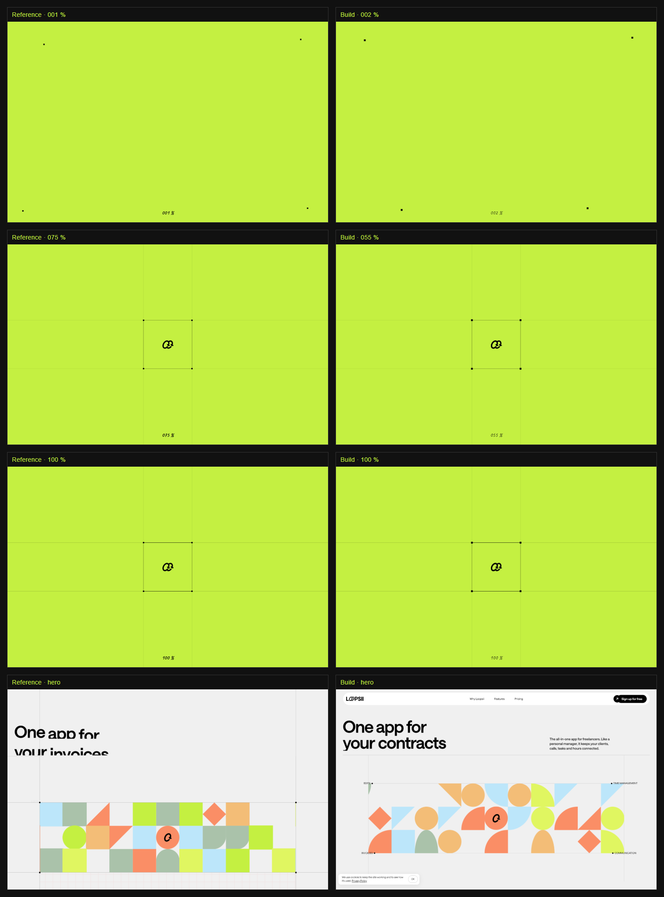
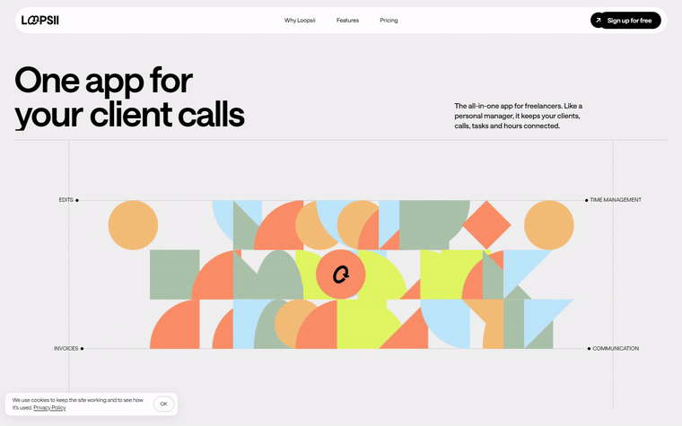
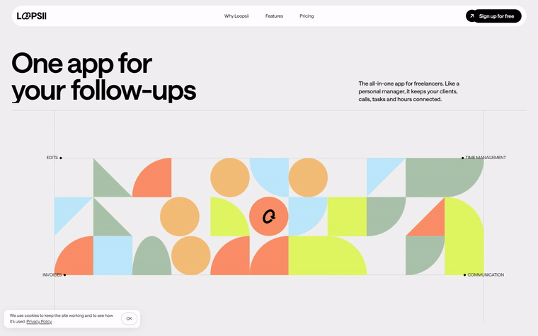
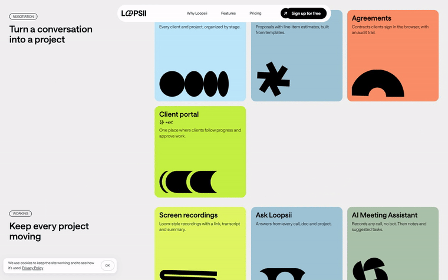

# Loopsii — private study recreation

A hand-built static study recreation of [loopsii.com](https://loopsii.com/), made to practise front-end
structure, CSS layout and scroll-driven motion.

---

## ⚠️ Study-build notice — read this first

**The design, art direction, copy, images, fonts, video and audio belong to Loopsii and their original creators.**

This is a **private study / reference recreation**. It is **not affiliated with, endorsed by, or produced by Loopsii**.
It **must not be deployed, published, sold, distributed, or presented as your own work**, and it must not be used
commercially in its current form.

If you later want to publish a site inspired by this, treat it as a separate project: **replace every borrowed asset
and all of the copy**, write your own layouts and motion, and obtain the appropriate licences for any fonts or media
you keep. The provenance list below is the replacement checklist.

The page also carries an in-file header notice and a visible footer disclaimer.

---

## Run it

No build step. Serve the folder with any static server:

```sh
# from this directory
python -m http.server 5173
# or
npx serve .
# or the bundled evidence server
node evidence/tools/serve.mjs
```

Then open <http://localhost:5173>. Opening `index.html` directly also works, but a local server is recommended
because the page uses `@font-face` and a local video.

Files:

```
index.html          the page
css/styles.css      all layout / type / responsive rules
css/motion.css      motion layer: split reveals, field, stack/highlight/feature beats
js/app.js           loader, nav, hero word cycle, scroll scenes, carousel, pricing, FAQ, clock, particles
js/motion.js        hero field, intro logo travel + orbit, stack/highlight/feature motion, gauge
vendor/lenis.min.js Lenis smooth scroll (vendored)
vendor/lottie_light.min.js  Lottie player (vendored, MIT)
assets/             fonts, images, SVGs, Lottie JSON, video (borrowed — see provenance)
evidence/           reference frames, build QA frames and the capture/QA scripts
```

## What is implemented

- Preloader matched to the reference: lime sheet, full-bleed crosshair, centred 218×218 frame, four corner dots
  flying in, handwritten `000 %` counter, the double-loop Lottie mark, then a handoff into the hero's coral loop.
- Full-width nav that morphs into a compact pill on scroll; anchor links use Lenis.
- Hero: cycling headline, a 3×21 shape field cropped to 11 columns, shapes shuffling between slots and changing
  form, a compact “breathe” every few steps, corner labels and rules.
- Intro: the coral loop travels from the hero into the intro logo, then the app-glyph orbit moves around it;
  the headline, label and note reveal word by word.
- Distraction: 300svh sticky dark scene, blurred portrait, tags flying in, parentheses.
- App demo (desktop): pinned lime scene with a pixel field; the title starts at ~125 px, shrinks to 55 px
  as you scroll while the mock Loopsii dashboard rises and fills the scene.
- Stack: ruled grid whose lines draw in individually, six tool cards popping in row by row, rotating
  brand swaps, a count-up yearly total, a giant lime loop mark with dashed orbit and pills, badge/stem and
  a `$120/yr` hub card, then the lime import CTA.
- Highlights: six stacking cards with depth scale/rotation, an animated income gauge, kanban/timeline/request
  staggers and a dictation waveform.
- Folders, feature groups with 18 **inline** SVG glyphs that run their own looping timelines (spin, slide,
  waveform, draw), 3D card entrances on scroll and hover states; testimonial carousel, monthly/yearly pricing,
  scrolling roadmap wheel, waitlist counter + clock canvas, FAQ accordion, outro waves + particles, footer video
  card.
- Section headings split into masked word reveals; responsive layouts at 390 / 768 / 1024 / 1440 / 1728;
  reduced-motion fallback that keeps all content visible and collapses the animated scenes.

### Preloader comparison

Reference (left) and this build (right), captured at the same phase:



### Motion evidence

Reference frames and the matching build frames live in `evidence/reference/motion/` and
`evidence/build/motion/`.

Hero shape field (GIF): 

Hero-to-intro logo travel and orbit (GIF): 

Feature glyph timelines (GIF): 

App demo title shrink and dashboard rise: `evidence/build/motion/08-app-title-4800.png` →
`09-app-title-5300.png`; the live equivalents are in `evidence/reference/motion/`.

## Not implemented / known gaps

- The loader mark scales/fades in over 0.6 s instead of the reference's 4-frame Lottie draw; the layout, counter,
  dots, lines and handoff are matched frame-for-frame.
- The reference's scroll layer is GSAP + ScrollTrigger/ScrollSmoother/SplitText/DrawSVG/MorphSVG/MotionPath with a
  WebGL shader for the blurred portrait and the app-demo reveal. This build uses vanilla CSS/WAAPI/rAF, so the
  results are the same beats with simpler easing and no shader.
- Feature glyphs are the reference's own inline SVGs driven by a vanilla port of its per-icon timelines; the
  DrawSVG trim loops on the three outline glyphs are approximated with a small pulse, and the meetings/dictation
  loops are simplified.
- Hero shape changes are a quick scale/pop between shape classes, not a MorphSVG path morph.
- The original's interactive in-app demo is replaced by a static mock dashboard. The desktop scene still pins and
  rises, but the embedded product is not interactive.
- The testimonial deck's exact paper/wireframe layering is simplified; the reference's per-slide motion is reduced to
  a faded neighbour state.
- The nav overlay panel and page transitions from the original are not reproduced.
- The roadmap wheel uses a snapped four-card rotation rather than the original's per-frame wheel maths.
- The original's analytics, consent platform and form handling are intentionally absent.
- Some micro-typography inside the dashboard mock is approximate at small sizes.
- Asset fidelity is limited to what the public site served (for example the blurred portrait is the site's 640×367
  cover image, scaled up).

## Asset provenance

All paths are relative to this folder. Source URLs are the public files served by loopsii.com at the time of the study
(November 2026).

### Fonts

| Local path | Source | Notes |
| --- | --- | --- |
| `assets/_astro/fonts/f1306f12b629075b.woff2` | `https://loopsii.com/_astro/fonts/f1306f12b629075b.woff2` | Saans VF — the site's sans (headings and UI) |
| `assets/_astro/fonts/fd3499837a53ca88.woff2` | `https://loopsii.com/_astro/fonts/fd3499837a53ca88.woff2` | Caveat VF — handwritten notes |

Do not redistribute either font. Licence them from their foundries before any public use.

### Images and video

| Local path | Source |
| --- | --- |
| `assets/img/cover.DgwvykuR.webp` | `https://loopsii.com/_image?href=%2F_astro%2Fcover.DgwvykuR.png&w=640&h=367&q=70&f=webp` |
| `assets/testimonials/isabel.webp` | `https://loopsii.com/testimonials/isabel.webp` |
| `assets/testimonials/marina.webp` | `https://loopsii.com/testimonials/marina.webp` |
| `assets/testimonials/andres.webp` | `https://loopsii.com/testimonials/andres.webp` |
| `assets/testimonials/nika.webp` | `https://loopsii.com/testimonials/nika.webp` |
| `assets/testimonials/anna.webp` | `https://loopsii.com/testimonials/anna.webp` |
| `assets/video/footer-dual.mp4` | `https://loopsii.com/video/footer-dual.mp4` |
| `assets/favicon.svg` | `https://loopsii.com/favicon.svg?v=4` |

### Lottie animations

| Local path | Source | Used for |
| --- | --- | --- |
| `assets/lottie/logo-left.json` | `https://loopsii.com/lotties/logo-left.json` | Left half of the loader mark |
| `assets/lottie/logo-right.json` | `https://loopsii.com/lotties/logo-right.json` | Right half of the loader mark |
| `assets/lottie/logo-loop.json` | `https://loopsii.com/lotties/logo-loop.json` | Hero coral-loop mark |
| `vendor/lottie_light.min.js` | `https://unpkg.com/lottie-web@5.12.2/build/player/lottie_light.min.js` | Player (MIT licence) |

The three JSON files are Loopsii's own brand animations. They are borrowed for the study only and must be replaced
before any public use.

### Interface SVGs

All under `https://loopsii.com/`:

- `assets/dashboard/`: `logo-mark.svg`, `icon-search.svg`, `icon-home.svg`, `icon-timer.svg`, `icon-blocks.svg`,
  `icon-users.svg`, `icon-play.svg`, `icon-plus.svg`, `icon-clock.svg`, `timer-circle.svg`.
- `assets/highlights/`: `cursor-arrow.svg`, `cursor-hand.svg`, `icon-message.svg`, `icon-pencil.svg`,
  `icon-mic.svg`, `icon-gear-search.svg`, `icon-gear-ask.svg`, `icon-spark.svg`.
- `assets/folders/`: `folder-196.svg`, `folder-204.svg`, `folder-205.svg`, `folder-206.svg`, `folder-207.svg`,
  `folder-208.svg`, `folder-209.svg`.
- `assets/icons/logo.svg` was extracted from the inline SVG wordmark in the page.
- `assets/icons/features/card-*.svg` are the site's eighteen feature-card glyphs, extracted from inline SVGs.

### Copy and imagery inside the page

All headlines, body copy, FAQ answers, testimonial quotes, pricing details, roadmap entries and product data are
reproduced from loopsii.com for study purposes only. The testimonial photographs remain the property of the people
pictured and the site owner.

`assets/img/app-mock.png` is a screenshot of **this recreation's own mock dashboard**, not a borrowed image.

## If you intend to publish

1. Replace every asset in `assets/` (fonts, photos, SVGs, Lottie JSON, video) and `assets/img/app-mock.png`.
2. Rewrite all copy — the text is the original site's.
3. Redraw the feature glyphs, folder art, hero shape field, loader mark and dashboard mock.
4. Rebuild the brand identity (logo, palette, type) from scratch.
5. Only then deploy.

---

Built as a study exercise. Not for production.
